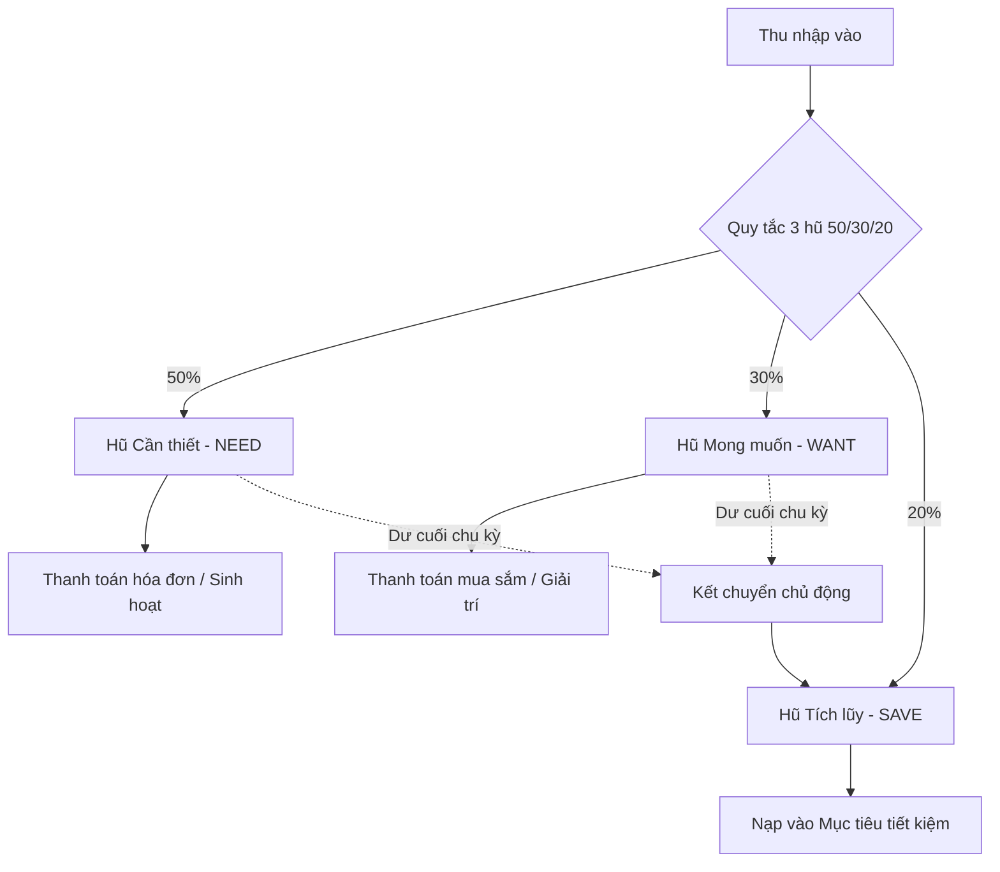

# Moneda 🪙
> **Quản lý tài chính cá nhân thông minh theo quy tắc 3 hũ (50/30/20)**  
> Phong cách thiết kế tối giản, hiện đại chuẩn ứng dụng tài chính số với tông màu Xanh biển đậm (`#1E40AF`), Trắng và Xám trung tính — Tối ưu hóa cho **iOS Native** & **Web**.

---

## 📌 1. Bài toán thực tế & Giải pháp của Moneda

### 🔴 Vấn đề thực tế
Đa phần người đi làm và bạn trẻ hiện nay giữ toàn bộ thu nhập hàng tháng trong **một tài khoản ngân hàng duy nhất**:
- **Ngộ nhận số dư khả dụng:** Khi thấy tài khoản còn nhiều tiền, người dùng có xu hướng thoải mái chi tiêu cho các nhu cầu ăn uống, mua sắm lặt vặt không cần thiết.
- **Tiêu lạm vào tiền tiết kiệm & tiền thiết yếu:** Đến cuối tháng, các khoản tiền thuê nhà, hóa đơn điện nước hay tiền tích lũy đều bị "ăn lẹm", dẫn đến tình trạng rỗng túi và không có quỹ dự phòng khẩn cấp.
- **Ghi chép thủ công tốn thời gian:** Các app quản lý tài chính truyền thống bắt phân loại quá nhiều danh mục chi li, làm người dùng nản lòng sau vài ngày.

### 🟢 Giải pháp đột phá từ Moneda
Moneda áp dụng triệt để **Quy tắc 3 hũ ngân sách 50/30/20** của các chuyên gia tài chính thế giới:
1. **Hũ Cần thiết (NEED - 50%):** Tiền thuê nhà, ăn uống cơ bản, điện nước, xăng xe, y tế.
2. **Hũ Mong muốn (WANT - 30%):** Mua sắm, xem phim, cà phê, du lịch, giải trí cá nhân.
3. **Hũ Tích lũy (SAVE - 20%):** Quỹ dự phòng khẩn cấp, tiết kiệm mua sắm lớn, đầu tư dài hạn.

Ngay khi nhận một khoản tiền, Moneda **tự động phân bổ** vào 3 hũ riêng biệt. Khi chi tiêu, tiền chỉ được trích từ hũ tương ứng. **Hũ nào hết tiền thì lập tức bị khóa chi tiêu cho hũ đó**, bảo vệ quỹ tích lũy một cách tự nhiên và bền vững.

---

## 🚀 2. Các tính năng cốt lõi

### 1. Thẻ số dư Carousel & Chế độ ẩn/hiện số dư tĩnh lặng
- Khối thẻ số dư trượt ngang 4 trang mượt mà: **Tổng số dư**, **Hũ Need (Xanh biển)**, **Hũ Want (Tím)**, **Hũ Save (Xanh ngọc)**.
- Nút con mắt giúp ẩn số dư tức thì khi ở nơi công cộng, tự động lưu trạng thái bảo mật vào `SharedPreferences`.

### 2. Nhận tiền & Phân bổ tự động chuẩn từng đồng
- Nhập số tiền thu nhập bất kỳ, hệ thống tính toán phân bổ vào 3 hũ theo thời gian thực.
- Thuật toán `MonedaValidator.calculateIncomeAllocation` đảm bảo **bảo toàn 100%**, xử lý phần dư làm tròn chính xác tuyệt đối, không lệch dù chỉ 1 đồng VND.
- Hỗ trợ tùy chọn phân bổ tự động theo tỷ lệ hoặc nạp thẳng 100% vào một hũ chỉ định.

### 3. Thanh toán thông minh & Chặn tuyệt đối chi tiêu âm quỹ
- Giao diện thanh toán 4 trường tinh gọn: *Hũ chi tiêu*, *Số tiền*, *Danh mục*, *Nội dung chi tiết*.
- **Floating Suggestions Dropdown:** Chạm vào ô nhập là nổi danh sách gợi ý danh mục và nội dung sắp xếp theo **tần suất chi tiêu cao nhất**, tự động lọc khi gõ phím mà không đẩy tụt các thành phần giao diện phía dưới.
- **Chặn âm quỹ (Anti-Negative Balance):** Tự động so sánh số tiền nhập với số dư thực tế của hũ đã chọn. Nếu số tiền vượt số dư, hệ thống báo đỏ cảnh báo và khóa nút Tiếp tục.

### 4. Kết chuyển tiền dư sang Hũ Tích lũy (Rollover)
- Khi có thông báo nhắc nhở chu kỳ mới, bấm vào icon Chuông thông báo trên Header để mở màn hình **Kết chuyển tiền dư**.
- Cho phép người dùng chuyển toàn bộ số tiền còn thừa trong Hũ Need và Hũ Want sang Hũ Save để tăng tối đa tiền tiết kiệm.

### 5. Báo cáo & Sao kê ngân sách 3 tầng (Accordion)
- Theo dõi biến động thu nhập, chi tiêu và tăng trưởng tích lũy theo từng tháng.
- Sao kê phân tầng dạng Accordion trực quan, cho phép lọc theo hũ, thời gian và từ khóa giao dịch.

### 6. Quản lý Mục tiêu tiết kiệm (Saving Goals)
- Tạo mục tiêu tích lũy có kỳ hạn (mua laptop, quỹ du lịch, quỹ khẩn cấp...).
- **Nạp tiền:** Trích an toàn từ Hũ Save (không cho phép nạp vượt quá số dư Hũ Save).
- **Rút tiền:** Rút tiền đã tích lũy từ mục tiêu về lại các hũ khi đạt kế hoạch.

### 7. Tiện ích Slider tự cân bằng 100% & Chuyển tiền nội bộ
- **Slider tỷ lệ 3 hũ:** Thuật toán tự cân đối 3 trục, khi kéo bất kỳ thanh nào thì 2 thanh còn lại tự điều chỉnh để tổng luôn duy trì chính xác 100% ở mọi biên độ (kể cả chạm 0% hoặc 100%).
- **Chuyển tiền nội bộ:** Hỗ trợ linh hoạt chuyển tiền giữa các hũ khi phát sinh nhu cầu đột xuất.

### 8. Bảo mật tài khoản & Xác thực người dùng
- Hệ thống xác thực Supabase Auth bảo vệ toàn bộ dữ liệu tài chính theo từng `user_id`.
- Tự động duy trì phiên đăng nhập (Session Persistence) trên Safari / iPhone PWA và hỗ trợ đổi mật khẩu nhanh.

---

## 🛠️ 3. Kiến trúc kỹ thuật & Tech Stack

| Thành phần | Công nghệ sử dụng | Mục đích |
|---|---|---|
| **Framework** | [Flutter 3.x](https://flutter.dev) (Dart 3.x) | Ứng dụng đa nền tảng tối ưu cho iOS và Web |
| **Giao diện** | Material 3 + Custom Moneda Design | Màu chủ đạo `#1E40AF`, `#F8FAFC`, `#FFFFFF`, bo góc mềm 16-24px |
| **Backend & CSDL** | [Supabase](https://supabase.com) (PostgreSQL 15) | Lưu trữ đám mây, Row Level Security (RLS), Stored Procedures (RPC) |
| **Xác thực** | Supabase Auth | Đăng nhập tài khoản & phân quyền dữ liệu theo user_id |
| **Bảo mật cục bộ** | `flutter_secure_storage` | Lưu trữ token và mật khẩu mã hóa an toàn |
| **Bộ nhớ đệm** | In-Memory Zero-Spinner Caching | Mở app hiển thị số dư tức thì 0.0s, không màn hình chờ xoay vòng |
| **Xử lý bàn phím** | `GestureDetector` Root Unfocus | Chạm ra ngoài vùng nhập để hạ bàn phím số iOS mượt mà |
| **Kiểm thử & CI** | Flutter Test + GitHub Actions | 129 unit & widget tests tự động chạy kiểm thử 100% pass |

---

## 📲 Hướng dẫn Cài đặt Ứng dụng (iPhone & Android)

Bạn có thể cài đặt **Moneda** trực tiếp ra màn hình chính điện thoại chỉ trong **10 giây** mà không cần tải qua kho ứng dụng:

### 🍎 1. Đối với iPhone / iPad (iOS)
1. Mở trình duyệt **Safari** trên iPhone và truy cập vào đường link chính thức của ứng dụng trên **Vercel**.
2. Nhấn vào nút **Chia sẻ (Share)** (biểu tượng ô vuông có mũi tên hướng lên ở thanh công cụ dưới đáy màn hình).
3. Cuộn xuống và chọn **"Thêm vào Màn hình chính" (Add to Home Screen)**.
4. Nhấn **Thêm (Add)** ở góc trên bên phải. Biểu tượng **Moneda** sẽ xuất hiện ngay ngoài màn hình chính như một ứng dụng độc lập toàn màn hình!

### 🤖 2. Đối với Điện thoại Android (Samsung, Xiaomi, OPPO...)
1. Mở trình duyệt **Chrome** và truy cập vào đường link **Vercel** của ứng dụng.
2. Nhấn vào thông báo **"Cài đặt ứng dụng" (Install App)** hiện lên trên màn hình *(hoặc nhấn vào biểu tượng **3 chấm dọc `⋮`** ở góc trên bên phải Chrome $\rightarrow$ chọn **"Cài đặt ứng dụng" / "Thêm vào màn hình chính"**)*.
3. Nhấn **Cài đặt (Install)** để hoàn tất.

---

## 🛠️ Dành cho Lập trình viên (Developer)
- **Kiểm tra phân tích tĩnh:** `flutter analyze`
- **Chạy toàn bộ kiểm thử tự động:** `flutter test -r expanded`
- **Triển khai Production lên Vercel:** `flutter build web --release && vercel --prod`

---

## 👥 Đóng góp & Tác giả
- Tác giả: **Lê Văn Lực**
- Giấy phép: MIT License — bạn có thể tự do sử dụng và tùy biến cho mục đích cá nhân.
